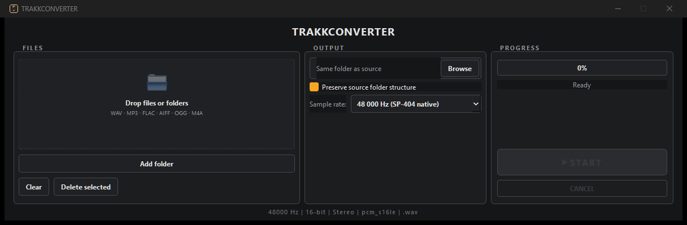

# TRAKKCONVERTER

> **Batch-convert any sample library to WAV the Roland SP-404MK2 accepts** — 48 kHz, 16-bit, stereo PCM. Drag and drop, folder structure preserved, portable exe, works offline.

**[Download for Windows](https://github.com/shardbeats/TRAKKCONVERTER/releases/latest)** · **[All 6 tools](https://shardbeats.github.io/tools/)** · **[Free beat pack (WAV + stems)](https://shardbeats.github.io/landing/)**

<!-- Screenshot: save the image as docs/screenshot.png, then uncomment this block
<p align="center"></p>
-->

Free and open source (MIT). Portable exe, no install, no account — your audio never leaves your computer.


Part of the ShardBeats **TRAKK SUITE** (ex `SP-404MK2SimpleConverter`).

Convert your sound libraries (drum kits, sample packs) to a format compatible with the **Roland SP-404 MK2** sampler.

## Target format (SP-404 MK2)
- **Sample rates:** 16 kHz, 22.05 kHz, 32 kHz, 44.1 kHz, 48 kHz, 88.2 kHz, 96 kHz, 176.4 kHz, 192 kHz
- **Bit depth:** 16-bit or 24-bit
- **Channels:** Mono (1) or Stereo (2)
- **Codec:** PCM signed 16-bit or 24-bit little-endian or big-endian
- **Container:** WAV (recommended: 48 kHz, 16-bit, stereo — the MK2 works internally at 48 kHz/16-bit)

## How files are handled
- **Already at target:** automatically copied (no conversion) when they already match the selected sample rate and meet the requirements.
- **Needs conversion:** converted to the selected rate (default 48 kHz), 16-bit, stereo PCM WAV.
- **Force to rate:** a compatible file at a different rate (e.g. 44.1 kHz with target 48 kHz) is resampled so the whole pack ends up uniform.
- **Compressed formats (MP3, AAC, etc.):** converted to the target format.
- **Already-converted files (`*_sp.wav`)** are skipped automatically, so a "mirror" folder is never re-converted.

## Requirements
- **Python 3.10+** - only needed to build or run from source
- **FFmpeg** on the system PATH - only needed to build or run from source
- (Recommended) The compiled `TRAKKCONVERTER.exe`, which is **fully portable**: it bundles its own FFmpeg, so the end user needs **neither Python nor FFmpeg**

### Installing FFmpeg (Windows)
1. Download from https://ffmpeg.org/download.html (the "essentials" build from gyan.dev).
2. Extract it and add the `bin` folder to your system PATH.
3. Verify: open PowerShell and run `ffmpeg -version`

## Installation

### Quick start (Windows, one click)
Just run **`start.bat`** in the project folder. It creates a virtual environment,
installs the dependencies and launches the app. Works on the first and every later run.

### From source (as a Python package)
```bash
# Clone or download this project, then from its folder:

# Option A: install the deps only and run with main.py
pip install -r requirements.txt
python main.py

# Option B: full install (creates the `trakkconverter` command)
pip install .
trakkconverter
```

### Classic venv setup
```bash
# Create a virtual environment (recommended)
python -m venv .venv
.venv\Scripts\activate

# Install dependencies
pip install -r requirements.txt
python main.py
```

## Usage
```bash
python main.py
```

Or just run the compiled `TRAKKCONVERTER.exe` (see build instructions below).

### Interface
1. **Drag & drop** folders or audio files onto the window. The conversion queue groups the samples by their source folder, showing a folder header above each group.
2. (Optional) Choose an **output folder** - by default files are saved next to their source.
3. **"Preserve source folder structure"** is enabled by default:
   - With an output folder selected: the whole source folder is recreated inside the output folder - `output/<pack>/<subfolders>/...` - with the converted files in place (e.g. `Out/Boombap/Bass/kick_sp.wav`).
   - Without an output folder: a `<source>_sp` folder is created next to each source folder, mirroring its structure.
   - Disabled: every converted file is saved flat in the output folder.
4. (Optional) Choose the **sample rate**: `48 000 Hz (SP-404 native)` by default, or `44 100 Hz (legacy)` for DAW-friendly packs.
5. Click **START**.
6. Converted files get the `_sp.wav` suffix.

> **Note for Windows:** if the app is run as Administrator, Windows blocks dragging files from File Explorer (the forbidden cursor 🚫 is shown). Run it normally; the app warns you automatically if it detects elevated privileges.

## Building a standalone .exe
The build script bundles `ffmpeg.exe` and `ffprobe.exe` from your system into the executable, so the result is a single portable file.

```bash
pip install pyinstaller
python build_exe.py
```
The executable will be at `dist/TRAKKCONVERTER.exe`.

> **Requirements for the build:** FFmpeg must be installed on the machine doing the build
> and available on its PATH (the build locates it with `shutil.which`). If FFmpeg is missing,
> the script warns you and produces an exe that is **not** portable.

### How the bundling works
- `converter.py` resolves the binaries with `sys._MEIPASS` when running inside the bundle (`ffmpeg_bin()` / `ffprobe_bin()`), and falls back to the system PATH when running from source (`python main.py`).
- `build_exe.py` passes `--add-binary "<path>\ffmpeg.exe;."` (and the same for `ffprobe.exe`) so both are extracted next to the app at runtime.
- Everything runs from a temporary folder that PyInstaller extracts at launch, so the `.exe` is the only file the user needs. No Python, no FFmpeg, no `styles.qss` required on the target machine.

### Custom icon
Drop a file named **`icon.ico`** in the project folder (any size; a multi-size 16-256 px icon is recommended). The build script detects it automatically:
- `--icon` sets it on the `.exe` file itself.
- It is bundled as a resource so the running window/taskbar shows it too.
Without `icon.ico` the build falls back to the default PyInstaller icon.

> **Note:** the one-file executable is large (~118 MB) because it includes Qt + FFmpeg.
> Some antivirus tools flag PyInstaller one-file builds; tell users it's a false positive
> or get a code-signing certificate for wider distribution.

## Supported input formats
`.wav`, `.mp3`, `.flac`, `.ogg`, `.m4a`, `.aac`, `.aiff`, `.aif`, `.wma`, `.opus`, `.webm`

## Tests
```
pip install -r requirements-dev.txt
python -m pytest tests -q
```

41 tests covering: SP-404 spec table, binary resolution, ffmpeg command
structure, ffprobe metadata, per-rule compatibility detection, output-path
resolution, file discovery and end-to-end conversion. The ffmpeg integration
tests generate tiny tones on the fly (no audio fixtures in the repo) and
skip gracefully if ffmpeg is not on PATH.

## Project structure
```
trakkconverter/
 main.py            # Entry point
 gui.py             # Main window + drag & drop + queue grouping
 converter.py       # FFmpeg logic + SP-404 spec detection
 build_exe.py       # PyInstaller build script for the standalone .exe
 setup.py           # pip installation (creates the `trakkconverter` command)
 start.bat          # One-click first-run setup + launch (Windows)
 styles.qss         # Stylesheet (QSS/CSS)
 requirements.txt
 README.md
```

## TRAKK SUITE

Six free, offline tools for beatmakers. They are independent: install only what you need.

| Tool | What it does |
|---|---|
| [TRAKKSTUDIO](https://github.com/shardbeats/TRAKKSTUDIO) | Organize, convert and normalize in a single window |
| **TRAKKCONVERTER** | Sample libraries → WAV for the Roland SP-404MK2 |
| [TRAKKNORMALIZER](https://github.com/shardbeats/TRAKKNORMALIZER) | Per-clip peak normalization for sample packs |
| [TRAKKNAME](https://github.com/shardbeats/TRAKKNAME) | Beat title generator (EN/ES, 20 moods) |
| [TRAKKOUT](https://github.com/shardbeats/TRAKKOUT) | Beat + artwork → 1080p MP4 for YouTube |
| [TRAKKLICENSE](https://github.com/shardbeats/TRAKKLICENSE) | Beat license contracts as PDF (EN/ES) |

- **Website:** https://shardbeats.github.io/tools/
- **Free beat pack (WAV + stems):** https://shardbeats.github.io/landing/
- **Sound kits:** https://www.beatstars.com/shardbeats/sound-kits

## FAQ

**Is it free?** Yes. MIT licensed, free for personal and commercial use, with no account and no usage limits.

**Why 48 kHz / 16-bit / stereo?** That is the SP-404MK2's internal format. Delivering anything else means the sampler resamples on import or rejects the file.

**Do I need Python or FFmpeg installed?** No. The portable `.exe` bundles its own FFmpeg.

**What formats can I feed it?** Anything FFmpeg decodes — MP3, AAC, FLAC, AIFF, OGG, M4A and existing WAV files. Compressed files are converted; files already at the target are copied, not re-encoded.

**Will it re-convert my already-converted files?** No. Files ending in `*_sp.wav` are skipped automatically, so a mirror folder is never processed twice.

**Does it work offline?** Yes. Nothing is uploaded.

**Which systems?** Windows 10 and 11, 64-bit.
